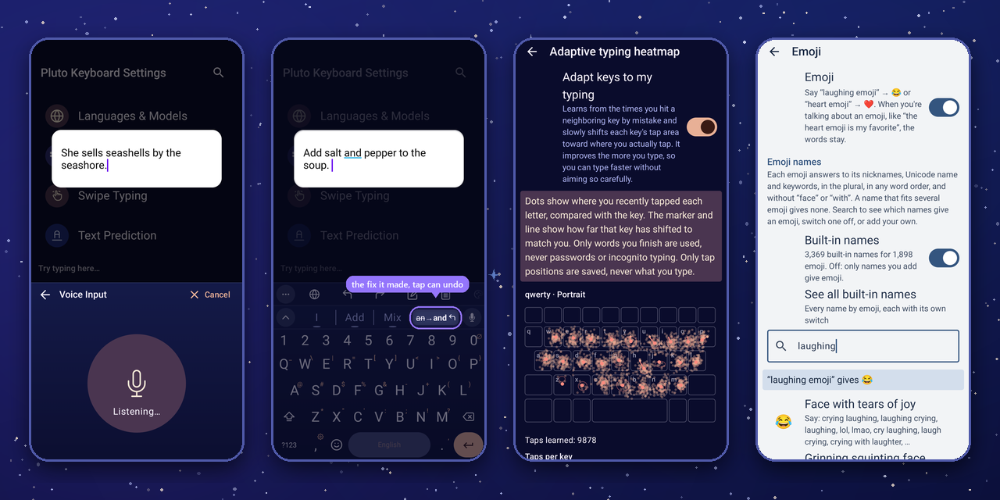
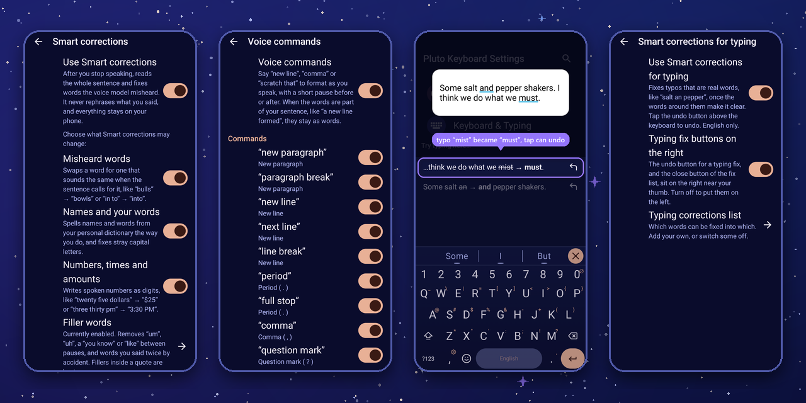

<b><a href="https://github.com/ColinCPittman/Futo-Keyboard-ASR-Heatmap/releases/latest">Download the APK</a></b> &nbsp;·&nbsp; <a href="#install">Install with Obtainium</a> &nbsp;·&nbsp; Android 7+ &nbsp;·&nbsp; no internet permission &nbsp;·&nbsp; built on <a href="https://keyboard.futo.tech/">FUTO Keyboard</a>

## Talk

Words appear while you speak, for as long as you speak, with nothing sent anywhere. Voice models sometimes mishear a word or chop a sentence up at a pause. Add the optional punctuation and Smart corrections models and Pluto puts back what you meant. It only swaps in words that sound alike and never rephrases you. Each extra, from voice commands to emoji by name, has its own switch and its own editable list.

## Type

Turn on Smart corrections for typing and Pluto catches typos that are real words, the ones a spell checker can't see, once the sentence makes them obvious. Every fix shows up in a chip above the keyboard, and one tap undoes it. Underneath, a heatmap learns where your thumb actually lands and quietly moves the keys to meet it.

## Why I built it

I made Pluto for a couple of reasons. First, I wanted a keyboard that learns my taps and builds a typing heatmap. I liked this about SwiftKey and missed it when I switched to FUTO (when typing fast, I kept hitting the letter next to the one I meant).

I also found that FUTO's Whisper models often missed the technical words I use for work. A larger Whisper distillation understood niche words better, but it came with a processing delay after longer recordings that quickly became tiresome. I knew that streaming models like Moonshine could address this, but FUTO didn't support them, so now Pluto does.

As I kept using Pluto with Moonshine, I found that it had drawbacks of its own, such as its tendency to add punctuation whenever you pause too long during dictation. This often turned the output into a series of sentence fragments. Many rounds of trying to fix this led to Smart Corrections, which addresses those drawbacks and adds features such as voice commands and emoji recognition. That foundation let me expand Smart Corrections to typing as well.

## Install

| | |
|:-:|---|
| **1** | **Get the app.** In [Obtainium](https://github.com/ImranR98/Obtainium), *Add App* → `https://github.com/ColinCPittman/Futo-Keyboard-ASR-Heatmap`. Or download the `.apk` from the [latest release](https://github.com/ColinCPittman/Futo-Keyboard-ASR-Heatmap/releases/latest). Android 7+, 64-bit. It installs next to FUTO Keyboard. |
| **2** | **Switch keyboards.** Open Pluto and follow the setup. Coming from FUTO? Export your configuration there and import it here (*Miscellaneous*, both sides). |
| **3** | **Add voice.** From the same release, download `pluto-voice-moonshine-small-en.zip`, plus `pluto-punctuation-en.zip` and `pluto-smart-corrections-en.zip` for the cleanup. Don't unzip; import under *Languages & Models*. [All models](docs/MODELS.md) |

<b>Privacy and bugs</b>

 

**Privacy.** No internet permission, so Android blocks every connection. The heatmap stores per-key numbers, never words. The only thing that saves dictations is a developer setting that is off by default.

**Bugs.** Tested mostly on one phone. [Open an issue](https://github.com/ColinCPittman/Futo-Keyboard-ASR-Heatmap/issues) here, not with FUTO.

## Credits and license

Pluto Keyboard is a modified version of [FUTO Keyboard](https://github.com/futo-org/android-keyboard) by FUTO, which in turn is built on [LatinIME, the Android Open Source Project keyboard](https://android.googlesource.com/platform/packages/inputmethods/LatinIME). Nearly all of what you see in Pluto is FUTO's work, and I am grateful to them for releasing it where people can build on it.

**Modification notice.** This is a modified copy of FUTO Keyboard, made by Colin Pittman for non-commercial use. My changes include the Moonshine streaming voice engine, the punctuation and Smart corrections steps for voice input (with voice commands, emoji by name and the other extras above), Smart corrections for typing, the adaptive typing heatmap, the "Always use middle suggestion" and "Correct words before punctuation" options, the personal dictionary and password-protection changes, and the Pluto name, icon and package ID (`io.github.colincpittman.plutokeyboard`). Pluto is **not affiliated with or endorsed by FUTO**, and if something is broken in Pluto, please report it here and not to FUTO.

**License.** The code is under the [FUTO Source First License 1.1](LICENSE.md). In plain terms: you can use it for anything, and you can modify and share it for non-commercial purposes, free of charge, as long as you keep the notices. FUTO's payment option has been left in the app, as the license requires. It supports FUTO, not me, and if you enjoy this keyboard I would encourage you to support them. The original AOSP notices are in [NOTICE](NOTICE).

**Third-party pieces** (full notices in [THIRD_PARTY_NOTICES.md](THIRD_PARTY_NOTICES.md)):

- [Moonshine](https://github.com/moonshine-ai/moonshine) speech recognition (MIT) and Silero VAD (MIT)
- [ONNX Runtime](https://github.com/microsoft/onnxruntime) (MIT)
- [llama.cpp](https://github.com/ggml-org/llama.cpp) (MIT) and [Qwen3](https://huggingface.co/Qwen/Qwen3-0.6B) (Apache-2.0), used for Smart corrections
- Punctuation models: [pcs_en](https://huggingface.co/1-800-BAD-CODE/punctuation_fullstop_truecase_english) (Apache-2.0) and [Horizon-Labs punctuation-restoration-small](https://huggingface.co/Horizon-Labs/punctuation-restoration-small) (Apache-2.0)
- The Smart corrections sound-alike list, derived from CMUdict (BSD-style), wordfreq data (CC BY-SA 4.0) and capitalization from the AOSP English word list (Apache-2.0)
- Emoji names for "thumbs up emoji": the official names, aliases and tags in the [gemoji](https://github.com/github/gemoji) list FUTO Keyboard already ships (MIT), which uses the [Unicode CLDR](https://cldr.unicode.org/) emoji names (Unicode License v3)

## Building from source

If you would like to build Pluto yourself, see [docs/BUILDING.md](docs/BUILDING.md). To make your own voice, punctuation or Smart corrections model packages, see [docs/MODELS.md](docs/MODELS.md). What changed in each version is on the [releases page](https://github.com/ColinCPittman/Futo-Keyboard-ASR-Heatmap/releases).
